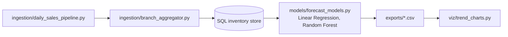
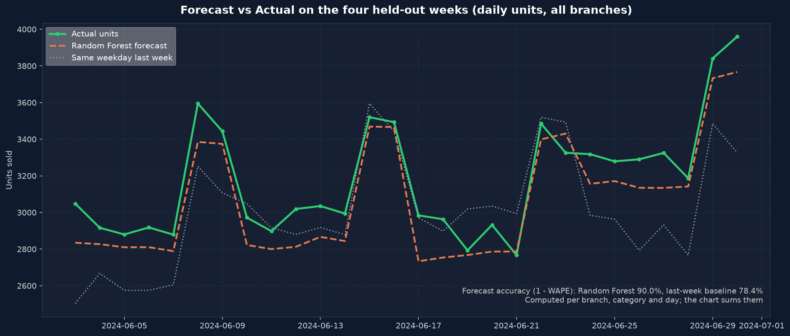

# AI-ML Data Science Simulation

[](https://github.com/Deshraj-Jogiya/AI-ML-Data-Science-Simulation/actions/workflows/ci.yml) 

A retail data pipeline run on simulated data: daily sales ingestion for 5 branches, centralized inventory in SQL, demand forecasting with
Linear Regression and Random Forest, and trend charts.

## Highlights

- **Multi-branch ETL:** daily sales for 30 products at 5 simulated branches over a year (2023-07-01 to 2024-06-30, 54,900 records),
  aggregated by `ingestion/branch_aggregator.py`.
- **Planned promotions:** each branch runs week-long category promotions (260 branch-category weeks, +30–60% demand), published
  ahead of time in a `promotions` table the way a real promotion calendar is.
- **Forecasting:** daily demand per branch and category, predicted only from data at least a week old plus the promotion calendar,
  so a weekly reorder can use it. On the four held-out weeks the Random Forest reaches **90.0% forecast accuracy** (1 − WAPE;
  R² 0.96) against 78.4% for a same-weekday-last-week baseline; Linear Regression reaches 85.9%. The Random Forest's depth and
  leaf size were chosen on the four weeks before the test window.
- **Reorder simulation:** topping stock up each week to the forecast plus 10%, instead of to last week's sales plus 10%, cut
  stock-out days by **60.8%** (51 → 20), units short from 7,038 to 419 (fill rate 92.1% → 99.5%) and unsold stock per
  branch-category week from 105 to 58 units. The gain comes from promotion weeks, which last week's sales can't anticipate;
  `exports/reorder_policy_comparison.csv` holds the numbers.
- **Leak-free evaluation:** the split is by date, not random, and a test checks that no feature can see the target day or the six
  days before it.
- **Trend charts:** weekly revenue, category mix and forecast vs actual (`viz/trend_charts.py`, matplotlib), plus CSV exports in
  `exports/` that feed the Tableau Public dashboard.

## Architecture





## Stack

Python, SQL, pandas, scikit-learn, Matplotlib, Tableau Public, pytest, GitHub Actions.

## Run it

```bash
pip install -r requirements.txt
python ingestion/daily_sales_pipeline.py
python ingestion/branch_aggregator.py
python models/forecast_models.py
python viz/trend_charts.py
python -m pytest tests/ -v
```

## Data

Everything here is simulated: the results describe the method, not a real retailer.
