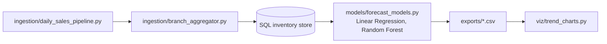

# AI-ML Data Science Simulation

[](https://github.com/Deshraj-Jogiya/AI-ML-Data-Science-Simulation/actions/workflows/ci.yml) 

A retail data pipeline run on simulated data: daily sales ingestion for 5 branches, centralized inventory in SQL, demand forecasting with
Linear Regression and Random Forest, and trend charts.

## Highlights

- **Multi-branch ETL:** daily sales for 30 products at 5 simulated branches over 90 days (13,500 records), aggregated by
  `ingestion/branch_aggregator.py`.
- **Reconciliation:** daily cross-branch checks keep the branch datasets consistent.
- **Forecasting:** daily demand per branch and category, predicted only from data at least a week old so a weekly reorder can
  use it. On the four held-out weeks the Random Forest reaches **90.4% forecast accuracy** (1 − WAPE; R² 0.96) against 87.8% for
  a same-weekday-last-week baseline, and Linear Regression reaches 90.2%.
- **Reorder simulation:** topping stock up each week to the forecast plus 10% cut stock-out days from 7 to 3 compared with
  reordering last week's sales, but left slightly more units short (204 vs 109) at a 99.7% vs 99.9% fill rate. Demand in this
  simulation is steady week to week, so the forecast's edge over the simple policy is small; `exports/reorder_policy_comparison.csv`
  holds the numbers.
- **Leak-free evaluation:** the split is by date, not random, and a test checks that no feature can see the target day or the six
  days before it.
- **Trend charts:** weekly revenue, category mix and forecast vs actual (`viz/trend_charts.py`, matplotlib), plus CSV exports in
  `exports/` that feed the Tableau Public dashboard.

## Architecture




## Stack

Python, SQL, pandas, scikit-learn, Matplotlib, Tableau Public, pytest, GitHub Actions.

## Run it

```bash
pip install -r requirements.txt
python ingestion/daily_sales_pipeline.py
python ingestion/branch_aggregator.py
python models/forecast_models.py
python viz/trend_charts.py
python -m pytest tests/ -v
```

## Data

Everything here is simulated: the results describe the method, not a real retailer.
