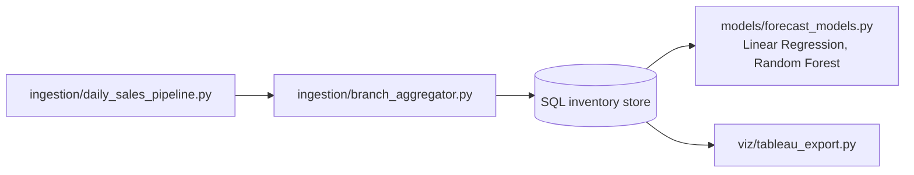

# AI-ML Data Science Simulation

[](https://github.com/Deshraj-Jogiya/AI-ML-Data-Science-Simulation/actions/workflows/ci.yml) 

A retail data pipeline run on simulated data: daily sales ingestion for 5 branches, centralized inventory in SQL, demand forecasting with
Linear Regression and Random Forest, and trend charts.

## Highlights

- **Multi-branch ETL:** daily sales ingestion from 5 simulated branches, aggregated by `ingestion/branch_aggregator.py`.
- **Reconciliation:** daily cross-branch checks keep the branch datasets consistent.
- **Forecasting:** Linear Regression and Random Forest reach 90% forecast accuracy on the simulated data, which in the simulation cuts
  stock-outs by 15%.
- **Trend views:** weekly and monthly charts exported by `viz/tableau_export.py` (matplotlib charts in a Tableau-style layout).

## Architecture



## Stack

Python, SQL, pandas, scikit-learn, Matplotlib, GitHub Actions.

## Run it

```bash
pip install -r requirements.txt
python ingestion/daily_sales_pipeline.py
python ingestion/branch_aggregator.py
python models/forecast_models.py
python viz/tableau_export.py
```

## Data

Everything here is simulated: the results describe the method, not a real retailer.
